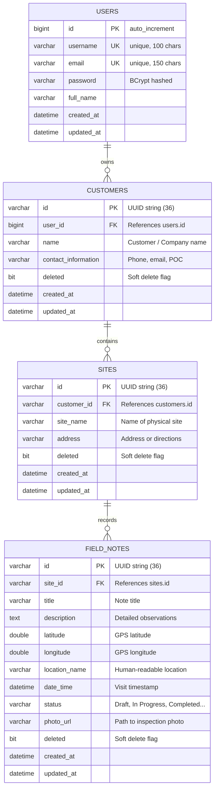

# Field Notes — Offline-First Mobile & REST Backend Solution

[]()
[]()
[]()
[]()
[]()

A complete, production-ready, offline-first solution designed for field workers to record, inspect, and manage site visit notes with or without active network connectivity.

---

## 📋 Table of Contents

1. [System Overview & Architecture](#-system-overview--architecture)
2. [Project Structure](#-project-structure)
3. [Core Workflows](#-core-workflows)
4. [Relational Database Design & Data Isolation](#-relational-database-design--data-isolation)
5. [Offline-First Architecture & Synchronization](#-offline-first-architecture--synchronization)
6. [Feature Highlights](#-feature-highlights)
   - [Default Note Status (Settings)](#default-note-status-settings)
   - [Search & Filtering with Relational JOINs](#search--filtering-with-relational-joins)
   - [Hardware Integration: GPS & Camera/Gallery](#hardware-integration-gps--cameragallery)
7. [API Specification](#-api-specification)
8. [Setup & Running Instructions](#-setup--running-instructions)
9. [Running Test Suites](#-running-test-suites)
10. [Configuration & Environment Variables](#-configuration--environment-variables)

---

## 🌟 System Overview & Architecture

Field inspections frequently take place in remote or shielded environments with intermittent or zero cellular connectivity (substations, basements, remote solar arrays, construction sites). 

This system resolves this challenge with an **Offline-First** architecture:
- **Local Autonomy**: All create, read, update, and delete (CRUD) operations execute against local encrypted **Hive** storage instantly without blocking the UI.
- **Relational Integrity**: Client-generated **UUID v4** identifiers allow field workers to create Customers, Sites under those Customers, and Field Notes under those Sites completely offline while preserving foreign key relationships.
- **Bidirectional Delta Synchronization**: When connectivity is available, an intelligent background sync engine pushes dirty local changes, uploads inspection photos, and pulls server-side updates.
- **Strict Data Isolation**: Users authenticate via JWT (JSON Web Tokens); each field worker has isolated access strictly to their own customers, sites, and notes.
- **Normalized Relational Backend**: Powered by Java 21, Spring Boot 3, and MySQL. Related customer and site details are dynamically resolved via SQL `JOIN FETCH` queries rather than storing duplicated customer or site data.

```
┌────────────────────────────────────────────────────────┐
│                   Mobile App (Flutter)                 │
│  ┌──────────────┐   ┌──────────────┐   ┌─────────────┐ │
│  │ UI & Screens │ ─>│ BLoC State   │ ─>│ Local Hive  │ │
│  │ (Material 3) │   │ Management   │   │ Storage     │ │
│  └──────────────┘   └──────┬───────┘   └──────┬──────┘ │
│                            │                  │        │
│                     ┌──────▼──────────────────▼──────┐ │
│                     │      Sync Service & Engine     │ │
│                     └────────────────┬───────────────┘ │
└──────────────────────────────────────┼─────────────────┘
                                       │ HTTP / REST (JWT)
                                       ▼
┌────────────────────────────────────────────────────────┐
│                 REST Backend (Spring Boot)             │
│  ┌────────────────────────┐    ┌────────────────────┐  │
│  │ Security & JWT Filter  │ ─> │ REST Controllers   │  │
│  └────────────────────────┘    └─────────┬──────────┘  │
│                                          │             │
│  ┌────────────────────────┐    ┌─────────▼──────────┐  │
│  │ File Storage (/uploads)│ <─ │ Domain Services    │  │
│  └────────────────────────┘    └─────────┬──────────┘  │
│                                          │             │
│                                ┌─────────▼──────────┐  │
│                                │ JPA Repositories   │  │
│                                │ (Relational JOINs) │  │
│                                └─────────┬──────────┘  │
└──────────────────────────────────────────┼─────────────┘
                                           │ JDBC
                                           ▼
                           ┌───────────────────────────────┐
                           │          MySQL 8.x            │
                           │ users, customers, sites, notes│
                           └───────────────────────────────┘
```

---

## 📁 Project Structure

```
field_notes/
├── backend/                               # Spring Boot REST API
│   ├── src/
│   │   ├── main/
│   │   │   ├── java/com/fieldnotes/
│   │   │   │   ├── config/                # Security, JWT, MVC WebConfig, GlobalExceptionHandler
│   │   │   │   ├── controller/            # Auth, Customer, Site, Note, Sync REST controllers
│   │   │   │   ├── dto/                   # Request/Response DTOs & Sync payloads
│   │   │   │   ├── model/                 # JPA Entities: User, Customer, Site, FieldNote
│   │   │   │   ├── repository/            # Spring Data JPA Repositories with JPQL JOIN queries
│   │   │   │   ├── service/               # Core business services & Sync Engine
│   │   │   │   └── FieldNotesApplication.java
│   │   │   └── resources/
│   │   │       └── application.properties # Datasource & JWT configuration
│   │   └── test/                          # Comprehensive integration test suite (H2 MySQL mode)
│   ├── pom.xml                            # Maven dependencies & build plugins
│   └── uploads/                           # Local storage for uploaded inspection photos
│
├── mobile/                                # Flutter Mobile Client
│   ├── lib/
│   │   ├── blocs/                         # BLoC State Management
│   │   │   ├── auth/                      # Authentication lifecycle (login, register, session)
│   │   │   ├── customer/                  # Customer CRUD & sync events
│   │   │   ├── site/                      # Site CRUD & sync events
│   │   │   ├── note/                      # Note CRUD, search & filter events
│   │   │   ├── settings/                  # Default note status & server configuration
│   │   │   └── sync/                      # Synchronization status & triggers
│   │   ├── core/
│   │   │   ├── constants/                 # Theme, colors, endpoints, preference keys
│   │   │   ├── network/                   # ApiClient with Bearer auth & multipart upload
│   │   │   └── services/                  # Hive StorageService, LocationService, MediaService, SyncService
│   │   ├── models/                        # Domain models with JSON & Hive map serialization
│   │   ├── views/                         # Material 3 UI Screens & Widgets
│   │   │   ├── auth/                      # Login & Registration screens
│   │   │   ├── home/                      # Main tabbed dashboard with sync indicator
│   │   │   ├── customers/                 # Customer list, detail, and form screens
│   │   │   ├── sites/                     # Site list, detail, and form screens
│   │   │   ├── notes/                     # Note list (search/filter), detail, and form screens
│   │   │   ├── settings/                  # Settings screen (Default Note Status, Server URL)
│   │   │   └── widgets/                   # StatusChip, SyncStatusBadge, EmptyState
│   │   └── main.dart                      # Application initialization & MultiBlocProvider setup
│   ├── test/                              # Unit & Widget tests
│   └── pubspec.yaml                       # Dependencies (flutter_bloc, hive, geolocator, etc.)
│
├── run-backend.sh                         # Helper script to launch MySQL & Spring Boot
├── run-app.sh                             # Helper script to launch Flutter mobile app
├── start-db.sh                            # Script to start user-space MySQL instance on port 3307
└── README.md
```

---

## 🔄 Core Workflows

### 1. Online Authentication
1. Field worker registers a new account or logs in with existing credentials (`POST /api/auth/register` or `POST /api/auth/login`).
2. Backend validates credentials, generates a cryptographically signed HMAC-SHA512 JWT token, and returns the user profile.
3. The token and user profile are securely cached locally in Hive for offline session persistence.

### 2. Offline Data Management
1. Once logged in, the worker can disconnect from the internet and continue working uninterrupted.
2. The user can create new Customers, add Sites under those Customers, and create Field Notes.
3. Because IDs are client-generated UUIDs, the user can create a Customer $\rightarrow$ immediately create a Site under that customer $\rightarrow$ immediately create Field Notes under that site, all while 100% offline.
4. Edits, deletions (soft-delete), and status changes are recorded in Hive with an `isSynced = false` flag.

### 3. Automatic Synchronization
1. When network connection is restored (or when the user taps "Sync Now"):
   - **Upload Media**: Any newly attached inspection photos stored locally are uploaded via `POST /api/notes/upload-photo`.
   - **Push Batch**: All un-synced customers, sites, and notes are batched into a `SyncPushRequest` and sent to `POST /api/sync/push`.
   - **Conflict Resolution**: Server applies "last write wins" based on `updatedAt` timestamps. Successfully synced IDs are returned and marked `isSynced = true` in Hive.
   - **Pull Delta**: Client calls `GET /api/sync/pull?sinceEpoch={lastSyncTime}` to fetch all server changes that occurred since the previous sync.
   - **Merge**: Pulled records are merged into Hive storage, and `lastSyncTime` is updated.

### 4. App Reinstallation & Fresh Device Restore
If the app is uninstalled, installed on a new phone, or local app cache is cleared:
1. The user logs in online.
2. The client executes an initial pull (`GET /api/sync/pull` without `since` parameter).
3. The backend returns all active customers, sites, and notes owned by that user.
4. Hive storage is fully populated with all historical data.

---

## 🗄️ Relational Database Design & Data Isolation

### Entity-Relationship Diagram



### Data Isolation & Relational Queries
- **Strict Data Isolation**: Every customer entity references `user_id`. Sites and Field Notes link transitively through customers to users. Repositories enforce ownership checks on every read, write, and delete:
  ```java
  @Query("SELECT n FROM FieldNote n JOIN FETCH n.site s JOIN FETCH s.customer c " +
         "WHERE c.user.id = :userId AND n.deleted = false")
  List<FieldNote> findAllByUserIdWithDetails(@Param("userId") Long userId);
  ```
- **Appropriate Relational Queries / JOINs**: Field notes do not duplicate customer name, customer address, or site name. When querying notes, Spring Data JPA performs SQL `JOIN FETCH` operations to hydrate the hierarchy in a single, high-performance query.

---

## ⚡ Feature Highlights

### Default Note Status (Settings)
As required by the specification:
- A dedicated **Settings** screen includes a **"Default Note Status"** selector (`Draft`, `In Progress`, `Completed`, `Pending`).
- The chosen status is saved locally in Hive/SharedPreferences.
- When opening the **New Field Note** form, the status dropdown is **automatically pre-selected** to this default value.
- The setting remains persistent across app restarts and is **never** synced to the backend.

### Search & Filtering with Relational JOINs
The Field Notes list view supports instantaneous multi-criteria searching and filtering:
- **Search bar**: Matches across note title, description, site name, and customer name.
- **Status Filter**: Quick horizontal chips for `All`, `Draft`, `In Progress`, `Completed`, `Pending`.
- **Site Filter**: Dropdown chip to filter notes by a specific site.
- **Offline & Online**: Uses local Hive filtering while offline, and JPQL relational JOIN queries (`GET /api/notes?query=...&status=...&siteId=...`) when interacting with the REST API.

### Hardware Integration: GPS & Camera/Gallery
- **Location Services**: Integrated via `geolocator`. Checks if location services are active, requests runtime permission, acquires high-accuracy GPS coordinates, and auto-populates latitude, longitude, and formatted coordinates on the note.
- **Media & Camera**: Integrated via `image_picker`. Allows field workers to take a live photo or select an existing photo from the device gallery with proper permission handling. Photos are cached locally and uploaded to the backend upon synchronization.

---

## 📡 API Specification

All endpoints (except `/api/auth/**` and public `/uploads/**`) require the HTTP header:
`Authorization: Bearer <JWT_TOKEN>`

### Authentication Endpoints
- `POST /api/auth/register`: Register new field worker
  ```json
  {
    "username": "fieldworker1",
    "email": "worker1@example.com",
    "password": "Password123!",
    "fullName": "Alex Mercer"
  }
  ```
- `POST /api/auth/login`: Authenticate and receive token
  ```json
  {
    "username": "fieldworker1",
    "password": "Password123!"
  }
  ```
  **Response**:
  ```json
  {
    "token": "eyJhbGciOiJIUzUxMiJ9...",
    "tokenType": "Bearer",
    "user": {
      "id": 1,
      "username": "fieldworker1",
      "email": "worker1@example.com",
      "fullName": "Alex Mercer"
    }
  }
  ```

### Customer Endpoints
- `GET /api/customers`: List all active customers with `siteCount` and `noteCount`.
- `GET /api/customers/{id}`: Get customer details by ID.
- `POST /api/customers`: Create customer.
- `PUT /api/customers/{id}`: Update customer.
- `DELETE /api/customers/{id}`: Soft-delete customer and cascade to sites/notes.

### Site Endpoints
- `GET /api/sites`: List sites (optional query param `?customerId=...`).
- `GET /api/sites/{id}`: Get site details by ID.
- `POST /api/sites`: Create site under customer.
- `PUT /api/sites/{id}`: Update site.
- `DELETE /api/sites/{id}`: Soft-delete site and cascade to notes.

### Field Note Endpoints
- `GET /api/notes`: Retrieve notes with relational customer and site data.
  - Supports query parameters: `query`, `status`, `siteId`, `customerId`.
- `GET /api/notes/{id}`: Get note details with joined customer & site information.
- `POST /api/notes`: Create note.
- `PUT /api/notes/{id}`: Update note.
- `DELETE /api/notes/{id}`: Soft-delete note.
- `POST /api/notes/upload-photo`: Multipart file upload for inspection photos (`file` field). Returns `{ "photoUrl": "/uploads/<uuid>.<ext>" }`.

### Synchronization Endpoints
- `GET /api/sync/pull`: Pull delta updates.
  - Query parameters: `since` (ISO-8601 string) or `sinceEpoch` (milliseconds).
  - Omit parameters for full initial pull on new device / reinstallation.
- `POST /api/sync/push`: Batch push offline records.
  ```json
  {
    "customers": [ ... ],
    "sites": [ ... ],
    "notes": [ ... ]
  }
  ```
  **Response**:
  ```json
  {
    "serverTime": "2026-10-12T01:00:00Z",
    "success": true,
    "syncedCustomerIds": ["cust-uuid-1"],
    "syncedSiteIds": ["site-uuid-1"],
    "syncedNoteIds": ["note-uuid-1"]
  }
  ```

---

## 🚀 Setup & Running Instructions

### Prerequisites
- **JDK 21** or higher
- **Maven 3.8+**
- **Flutter SDK 3.x+**
- **MySQL 8.x** (or use the included user-space launcher)

### 1. Launch MySQL & Backend
The repository includes automated scripts to start an isolated MySQL instance on port `3307` and boot the Spring Boot application:

```bash
# Option A: Start database and backend together
./run-backend.sh
```

Or start them individually:
```bash
# Start MySQL instance (runs in user-space without sudo)
./start-db.sh

# Start Spring Boot backend
cd backend
mvn spring-boot:run
```
The REST API will be live at `http://localhost:8080`.

### 2. Launch Mobile App
The mobile app can be launched as a web application (accessible from any browser), native Linux desktop app, or on mobile emulators/devices:

```bash
# Option A: Start Web Server (Recommended - runs on http://localhost:3000)
./run-app.sh

# Option B: Run as native Linux Desktop Application
./run-app.sh -d linux

# Option C: Run on Chrome / Brave browser
./run-app.sh -d chrome
```

> **Ubuntu 24.10/25.10 GTK Note**: In GNOME 47/48 on Ubuntu 24.10/25.10, the `antialiasing` key was relocated, causing unpatched GTK3 apps (Chrome and native Flutter Linux desktop) to abort with `GLib-GIO-ERROR`. This repository includes precompiled patched schemas in `.glib-schemas/` which `./run-app.sh` automatically configures via `GSETTINGS_SCHEMA_DIR`. Both `./run-app.sh -d linux` and `./run-app.sh -d chrome` will run cleanly. Alternatively, running `./run-app.sh` (or `flutter run -d web-server --web-port=3000`) runs as an HTTP web application accessible in any modern browser without relying on local GTK libraries.

> **Note for Android Emulators**: Use `http://10.0.2.2:8080` as the Backend Server URL in Settings or the Login screen. For physical Android devices, enter your machine's local Wi-Fi IP (e.g. `http://192.168.1.100:8080`).

---

## 🧪 Running Test Suites

### Backend Tests
Runs unit and integration tests using MockMvc, testing registration, CRUD, relational JOINs, user isolation, and push/pull sync against an in-memory H2 database in MySQL mode:
```bash
cd backend
mvn clean test
```

### Mobile Tests
Runs model serialization integrity tests and widget tests:
```bash
cd mobile
flutter test
```

### Code Quality Analysis
Verify zero warnings or analyzer errors:
```bash
cd mobile
flutter analyze --no-fatal-infos
```

---

## ⚙️ Configuration & Environment Variables

The backend supports full configuration via environment variables:

| Variable | Default Value | Description |
|---|---|---|
| `DB_HOST` | `localhost` | MySQL database host |
| `DB_PORT` | `3307` | MySQL database port (standard 3306 or local 3307) |
| `DB_NAME` | `field_notes` | MySQL database schema name |
| `DB_USER` | `root` | Database username |
| `DB_PASSWORD` | *(empty)* | Database password |
| `JWT_SECRET` | `9a3f8c2e6d1b4a705e83c2a1b9d4e7f60123...` | HMAC-SHA secret for signing JWTs |
| `UPLOAD_DIR` | `uploads` | Directory for storing uploaded photos |
| `PORT` | `8080` | Spring Boot HTTP server port |

---

## 📄 License
This project is open-source and available under the [MIT License](LICENSE).
